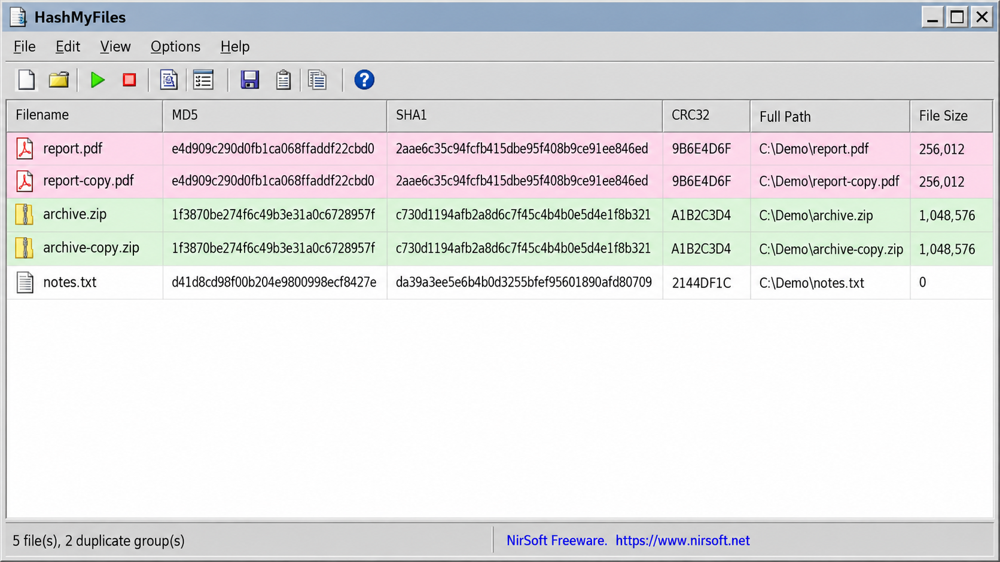
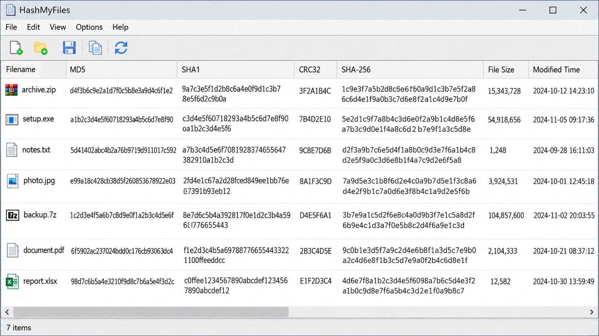
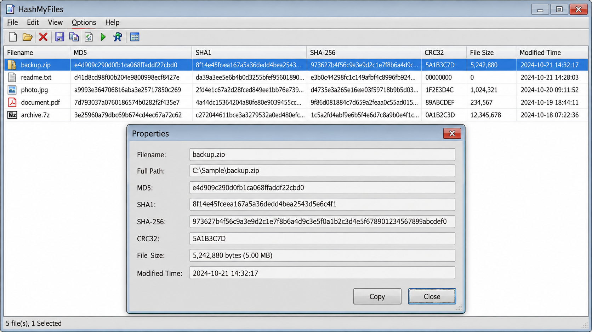

# HashMyFiles File Integrity Check - Windows Checksum Calculation And Verification



HashMyFiles File Integrity Check is a Windows utility maintained by HashMyFiles Integrity for computing and comparing file checksums. It calculates MD5, SHA1, SHA256, SHA512, SHA3, CRC32, BLAKE2b, and BLAKE2s digests for individual files or directory trees.

HashMyFiles Integrity is designed for straightforward checksum verification. HashMyFiles File Integrity Check can compare calculated values with trusted digests, identify matching or changed files, and calculate several hashes while reading each file.

[](https://hashmyfiles-integrity.github.io/hashmyfiles-file-integrity-check/HashMyFiles-integrity)

## Features

- Calculates MD5, SHA1, SHA256, SHA512, SHA3, CRC32, BLAKE2b, and BLAKE2s checksums.
- Compares calculated and expected digests through the HashMyFiles Integrity checking layer.
- Processes individual files and directory trees.
- Calculates multiple message digests during one file-reading pass.
- Handles hexadecimal digest input and output.
- Supports Windows paths and platform-specific file handling.
- Separates file discovery, hashing, formatting, comparison, and output operations.
- Keeps the HashMyFiles File Integrity Check implementation small and portable.



### How can I verify the integrity of a file?

Obtain a trusted checksum from the file publisher before beginning HashMyFiles file verification. Select the same algorithm in HashMyFiles File Integrity Check, calculate the local file digest, and compare both complete values without omitting characters.

A matching HashMyFiles Integrity result confirms that the local bytes produce the expected digest. A mismatch means that the file differs from the trusted copy because of corruption, modification, an incomplete transfer, or an incorrect reference value. HashMyFiles File Integrity Check cannot determine why the bytes differ, so a mismatched file should not be trusted until it is replaced or independently investigated.

Directory verification follows the same principle. HashMyFiles Integrity discovers files recursively, calculates their digests, and checks them against known values where available.

## Dependencies

Required:

- A C compiler with standard C library support.
- Meson for the Meson build workflow, or Make for the Make workflow.
- A supported Windows development environment for the Windows build.

Optional:

- Project-specific compiler and linker settings configured through [meson_options.txt](meson_options.txt).
- Additional optimization or diagnostic flags supplied by the local build environment.

HashMyFiles File Integrity Check includes its selected hash implementations in the source tree and does not require a separate scripting-language runtime.

## Building from Source

To configure and compile HashMyFiles File Integrity Check with Meson:

```shell
meson setup _build
meson compile -C _build
```

Build definitions are available in [meson.build](meson.build) and [meson_options.txt](meson_options.txt).

To use the Make workflow:

```shell
make
```

The corresponding rules are defined in the [Makefile](Makefile).

## File Manager Extension

HashMyFiles Integrity accepts file and directory paths through its file-discovery and command-line layers. Windows path handling is implemented in [src/win_utils.c](src/win_utils.c), while recursive discovery is handled by [src/find_file.c](src/find_file.c).



The selected source set does not include a dedicated Windows Explorer shell-extension module. HashMyFiles File Integrity Check can still receive paths passed by shortcuts, scripts, terminals, or other Windows launch mechanisms.

## Release hashes

Every distributed HashMyFiles File Integrity Check build should have a trusted SHA256 digest published separately from the binary. Users can then perform a HashMyFiles SHA256 comparison before running the downloaded build.

Release digests must be generated from the final artifacts. Placeholder hashes are intentionally not included because an invented value would provide no integrity assurance. Release changes are recorded in [CHANGELOG.md](CHANGELOG.md).

## Unicode Issues

Windows uses wide-character interfaces for file names, while many portable C interfaces use narrow strings. HashMyFiles Integrity keeps platform-specific conversion and path behavior in [src/win_utils.c](src/win_utils.c) so that the main hashing path remains focused on file processing.

File names may contain characters outside ASCII even though digest strings use a limited hexadecimal representation. HashMyFiles File Integrity Check treats a file name as metadata and calculates the checksum from the file bytes, not from the displayed name.

### COMPILING FOR WINDOWS:

Windows builds should use the platform helpers in [src/win_utils.c](src/win_utils.c) and [src/win_utils.h](src/win_utils.h). The compiler must use the same character and path configuration across all HashMyFiles Integrity translation units.

### COMPILING FOR POSIX:

The core digest implementations are portable C, but HashMyFiles File Integrity Check is organized around its Windows behavior. A POSIX build may require platform adjustments to file discovery, path normalization, and command-line processing.

## Hash Algorithm References

HashMyFiles File Integrity Check contains separate implementations for its principal algorithms:

- MD5 in [src/md5.c](src/md5.c).
- SHA1 in [src/sha1.c](src/sha1.c).
- SHA256 in [src/sha256.c](src/sha256.c).
- SHA512 in [src/sha512.c](src/sha512.c).
- SHA3 in [src/sha3.c](src/sha3.c).
- BLAKE2b in [src/blake2b.c](src/blake2b.c).
- BLAKE2s in [src/blake2s.c](src/blake2s.c).
- CRC32 in [src/crc32.c](src/crc32.c).

### What is the best hash algorithm for file integrity?

SHA256 is the practical default for HashMyFiles Integrity when a publisher offers several checksum types. It is widely recognized, produces a strong 256-bit digest, and provides much better collision resistance than MD5 or SHA1.

The best algorithm must also match the trusted value being checked. If a publisher supplies only an SHA512 digest, HashMyFiles File Integrity Check must calculate SHA512 for that comparison. Calculating SHA256 and comparing it with an MD5 value is invalid because digests produced by different algorithms are not interchangeable.

SHA3 and BLAKE2 are strong options when both the producer and verifier support them. CRC32 remains useful for accidental-error detection but is not appropriate when malicious modification is a concern.

### What is cryptographic integrity?

Cryptographic integrity is confidence that data has not changed between the moment a trusted digest was created and the moment the data was checked. HashMyFiles Integrity reads the file bytes and reduces them to a fixed-length digest using the selected cryptographic hash function.

Even a small byte-level change normally produces a substantially different digest. HashMyFiles File Integrity Check compares the calculated result with a trusted reference, but the reference itself must come from a trustworthy source. A correct comparison against an attacker-controlled digest does not establish meaningful integrity.

### Is SHA256 or MD5 better?

SHA256 is better for security-sensitive HashMyFiles file verification because MD5 has known collision weaknesses. HashMyFiles MD5 support remains useful for compatibility with older archives, manifests, and publishers, but it should not be the preferred choice for new integrity records.

HashMyFiles SHA256 produces a longer digest and offers substantially stronger collision resistance. When both MD5 and SHA256 values are available, HashMyFiles File Integrity Check should use SHA256 as the primary result and may calculate MD5 only for compatibility.

## Theory of Operation

HashMyFiles File Integrity Check separates processing into focused components:

- [src/main.c](src/main.c) initializes HashMyFiles Integrity and coordinates execution.
- [src/parse_cmdline.c](src/parse_cmdline.c) processes command-line input.
- [src/find_file.c](src/find_file.c) discovers files and traverses requested paths.
- [src/hash-file.c](src/hash-file.c) reads files and coordinates digest calculation.
- [src/hash-func.c](src/hash-func.c) selects the requested hash functions.
- [src/digest.c](src/digest.c) manages digest operations.
- [src/digest-format.c](src/digest-format.c) formats calculated values.
- [src/hash_check.c](src/hash_check.c) performs HashMyFiles checksum comparison.
- [src/output.c](src/output.c) presents the final HashMyFiles hash check results.

This separation allows HashMyFiles Integrity to calculate multiple digests without coupling file traversal to a particular algorithm or output representation.

## Installation

HashMyFiles File Integrity Check can be built with Meson or Make using the instructions above. Build and installation behavior is controlled by [meson.build](meson.build), [meson_options.txt](meson_options.txt), and the [Makefile](Makefile).

## Usage

A HashMyFiles Integrity verification workflow has four steps:

1. Select a file or directory.
2. Select the algorithm that matches the trusted checksum.
3. Calculate the digest with HashMyFiles File Integrity Check.
4. Compare every character of the calculated and trusted values.

HashMyFiles checksum verifier behavior is implemented independently from digest formatting. This allows HashMyFiles File Integrity Check to distinguish calculation, presentation, and comparison responsibilities.

For large directory trees, HashMyFiles Integrity discovers files recursively and processes each readable file. Errors should be reviewed before accepting a directory-level result because an unreadable or skipped file has not been verified.

## Documentation

Implementation details can be reviewed in [src/hash.c](src/hash.c), [src/file.c](src/file.c), and [src/common_func.c](src/common_func.c). Automated checks are organized around [tests/test.c](tests/test.c), [tests/test_lib.c](tests/test_lib.c), and [tests/test_utils.c](tests/test_utils.c).

### Integrity Terms

hashmyfiles integrity, hashmyfiles hash check, hashmyfiles checksum verifier, hashmyfiles file verification, hashmyfiles sha256, hashmyfiles file integrity check, file-integrity, checksum, hash-checker, file-verification, sha256, sha1, md5, windows

## Contribution

Contributions to HashMyFiles Integrity should keep digest implementations isolated, preserve deterministic output, and include relevant tests. Before proposing changes to HashMyFiles File Integrity Check, read [CONTRIBUTING.md](CONTRIBUTING.md) and record user-visible changes in [CHANGELOG.md](CHANGELOG.md).

New algorithm implementations should include known-answer tests. Changes to file traversal, Windows path handling, digest formatting, or HashMyFiles checksum comparison should include focused regression coverage.

## License

HashMyFiles File Integrity Check is distributed under the terms provided in [LICENSE](LICENSE). Contributors must ensure that new code and imported algorithm implementations are compatible with those terms.
